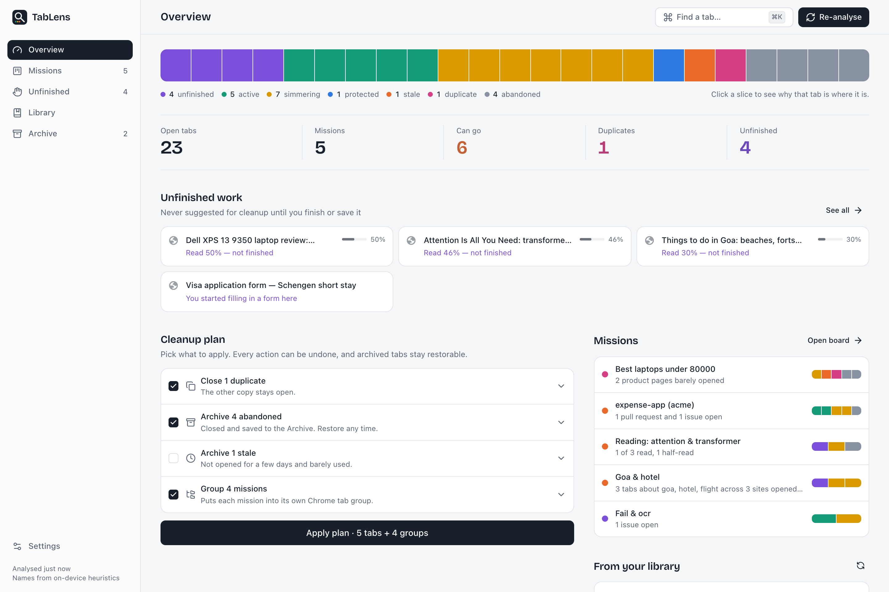
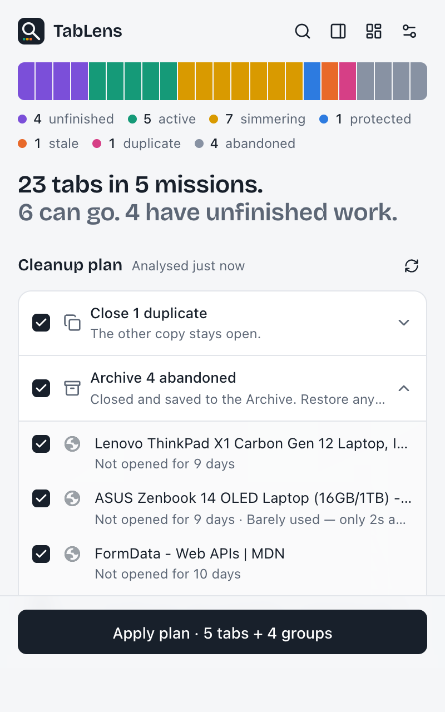
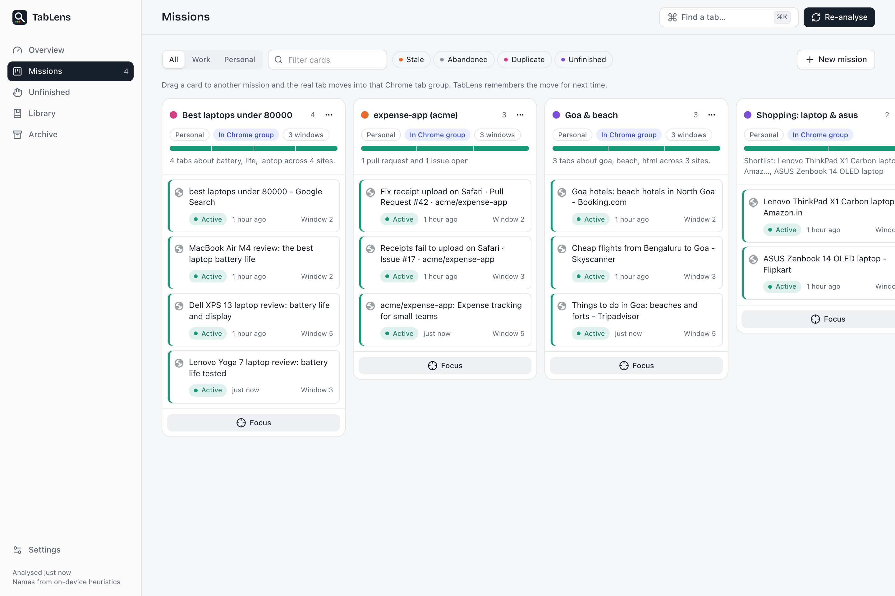
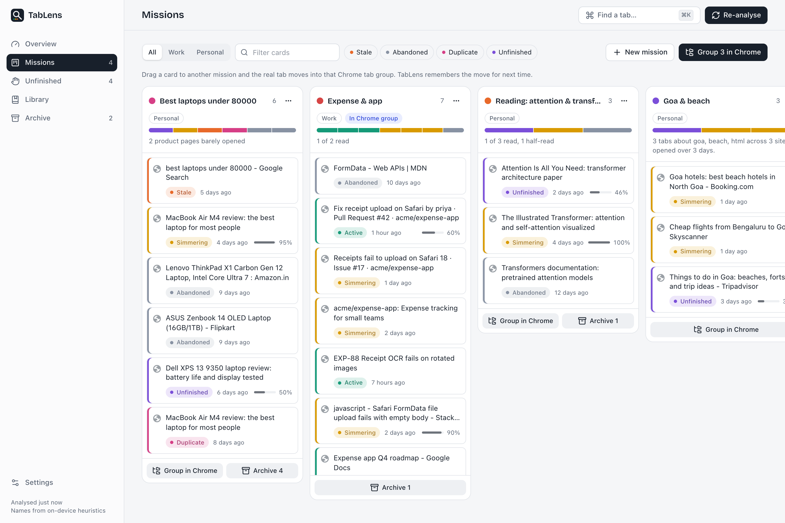
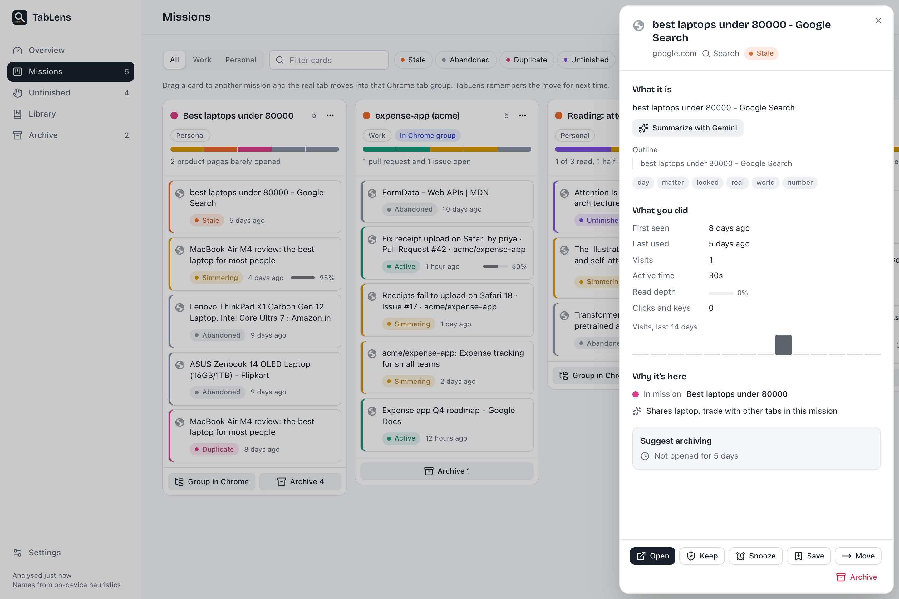
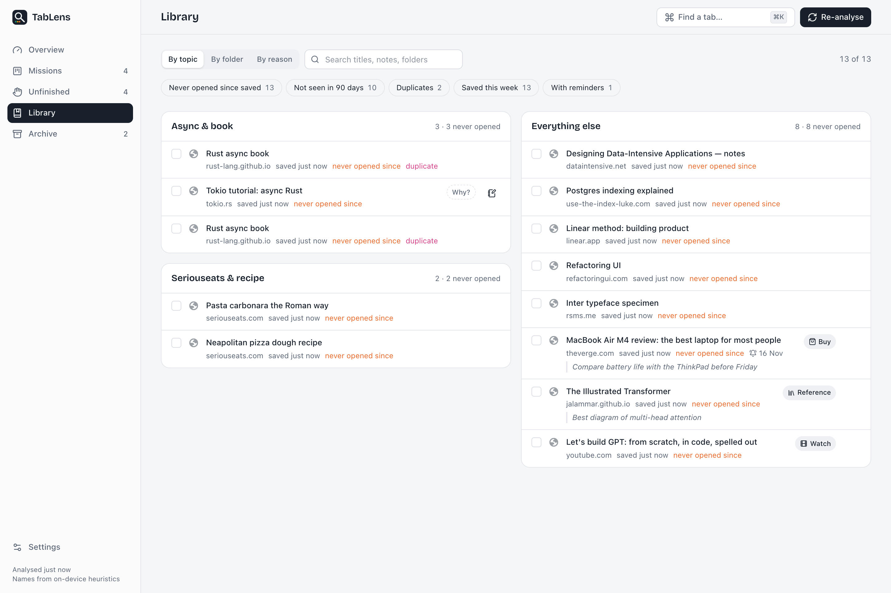
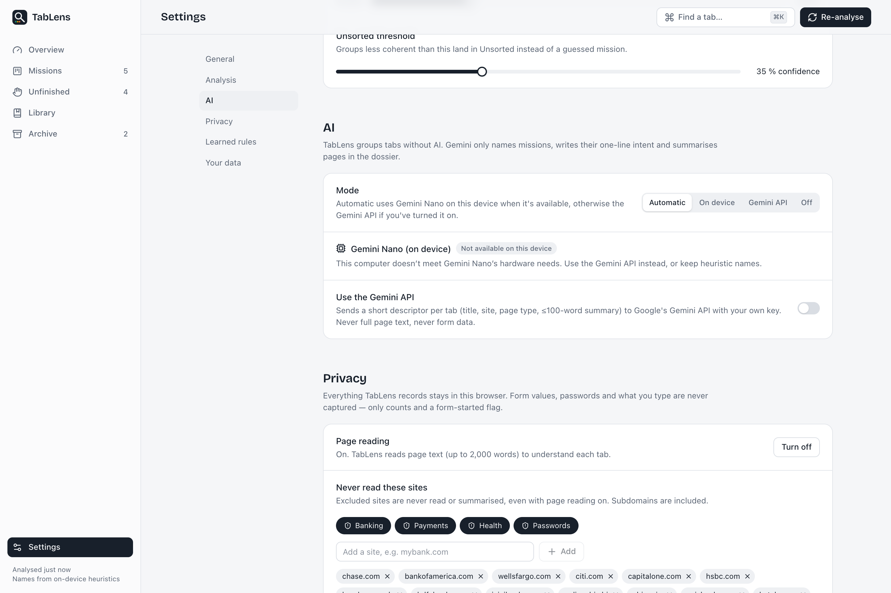
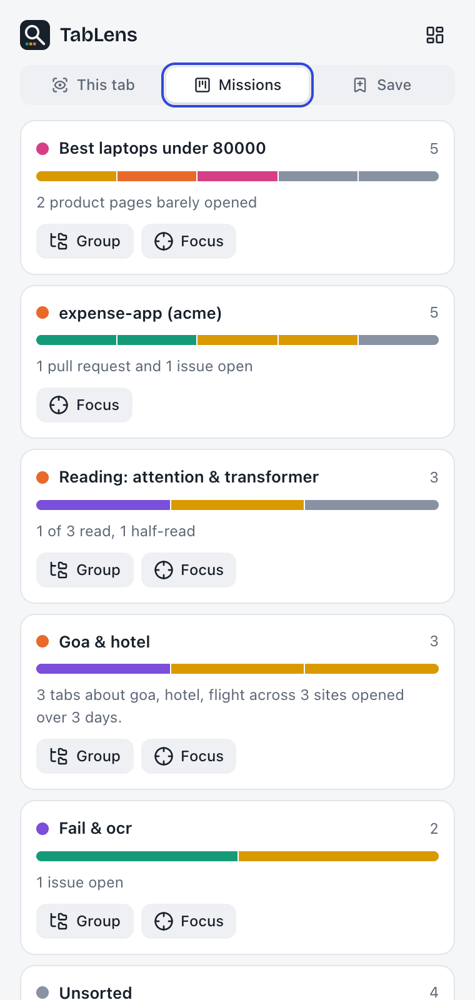
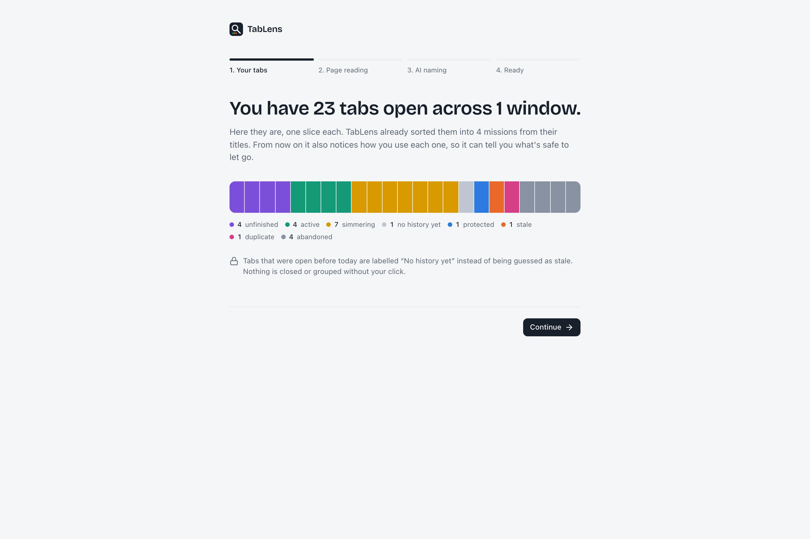

<p align="center">
  
</p>

<h1 align="center">TabLens</h1>

<p align="center">
  Reads what's in your tabs and remembers how you used them, then tells you — tab by tab — what to keep, what to group and what you can safely let go.<br>
  <strong>Nothing changes until you click.</strong>
</p>

<p align="center">
  
</p>

---

Most tab groupers sort by title and URL. TabLens adds two layers they don't have:

- **Content** — it reads the page itself (main text, headings, page type: article, product, docs, issue, form…), so it can tell a laptop review from a laptop job listing on the same site.
- **Behaviour** — from install onward it records how you used each tab: visits, active time (paused when you're idle or the window isn't focused), how far you scrolled, whether you started a form.

Together they let TabLens say things like *"You opened 9 laptop tabs over 6 days, read 3 of them properly, and haven't touched the rest since Tuesday."*

## What it does

### The Lens (toolbar popup)



- **The spectrum** — every open tab as one slice, sorted into bands by state: active, simmering, stale, abandoned, unfinished, duplicate, protected, no history yet. Hover a slice to see the tab; click to jump to it.
- **One-sentence verdict** — "23 tabs in 5 missions. 6 can go. 4 have unfinished work."
- **Cleanup plan** — *Close 1 duplicate*, *Archive 4 abandoned*, *Archive 1 stale*, *Group 4 missions*. Each row expands to the exact tabs it touches with the reason for each ("Not opened for 9 days · Barely used — only 2s active"). Untick anything. **Apply** runs only what's ticked, with a 30-second **Undo**.
- **Unfinished work is never in the plan.** Tabs with a started form or a half-read article are listed separately and kept for you.

<br clear="right">

### Real Chrome tab groups, across every window

TabLens doesn't just draw groups in its own UI — it creates and maintains **actual Chrome tab groups** (`chrome.tabGroups`), named and coloured after each mission, for tabs in **all** your browser windows.

Chrome groups can't span windows, so you choose (Settings → Grouping):

| Mode | What happens to a mission spread over 3 windows |
| --- | --- |
| **Gather into one window** (default) | Its tabs move into the window that already has the mission's group (or holds most of it) — one group per mission |
| **Group in each window** | Nothing moves; each window gets its own group with the mission's name and colour |

- **Keep groups in sync** (on by default): once a mission is grouped, new tabs that belong to it join its group automatically — in the same window, or gathered, per your mode. It only extends groupings you made; it never closes tabs.
- Pinned tabs, popup/app windows and incognito-vs-normal boundaries are respected; one mission failing never stops the rest.
- **Undo** puts every tab back in its original window and position — recreating a window if gathering emptied it.



### Missions board — drag the card, the real tab moves



- One column per **mission** (the task a group of tabs serves), with a mini spectrum, work/personal tag and an insight line: a shortlist for shopping ("2 product pages barely opened"), read vs unread for research, open PRs for code.
- **Drag a card into another column and TabLens moves the actual tab into that mission's Chrome tab group** — creating the group, moving it across windows and reordering the tab strip to match. Drop it on *Archive* to close and save it, or on *New mission* to start one.
- Every move is remembered as a **rule** (e.g. `github.com/acme/expense-app → Work: Expense app`) and applied first on the next analysis, so grouping gets better the more you use it.
- Rename a column (renames the Chrome group), recolour it, merge it into another, **Focus** on it (collapses every other group), or copy it as Markdown.

### Tab dossier — why every tab is where it is



Click any tab anywhere and a drawer explains it:

| | |
| --- | --- |
| **What it is** | Page type, summary (or a two-sentence Gemini summary on request), headings outline, topics |
| **What you did** | First seen, opened from which tab, last used, visits, active time, read depth, clicks and keys, form state, a 14-day visit sparkline |
| **Why it's here** | Which mission and the evidence ("Opened from your search “best laptops under 80000”", "Shares laptop, battery, m4 with other tabs", "Matches your rule"), then the verdict with its reasons |

Actions: Open, Keep (never suggest it), Snooze, Save with a note, Move to a mission, Archive.

### Library — bookmarks you can actually find again



Bookmarks record *what*, never *why*. The Library fixes that:

- **Save with intent** from the popup, side panel, dossier or right-click menu: pick *why* (Read later, Buy, Reference, Watch, To do, Inspiration), add a note, set a reminder. Saves are mirrored to a "TabLens saves" bookmarks folder so they outlive the extension.
- **Topic shelves** cluster all your bookmarks by subject — or view them by folder or by reason.
- **Last seen** on every item (Chrome's own last-used date plus TabLens's tracking), with filters for *never opened since saved*, *not seen in 90 days*, *duplicates*, *saved this week*, *with reminders*.
- Bulk set reason, move to folder, open all, delete. A "From your library" card on the overview resurfaces one forgotten save a day.

### And

- **Archive** — every tab TabLens closed, grouped by mission. Restore one, or **resume a whole mission in a new window**, regrouped.
- **Snooze** — close a tab now and have it reopen this evening, tomorrow morning, this weekend…
- **Already-open nudge** — open a page that's already open and a small chip offers *Switch to it*.
- **Quick find** (`⌘K`) — search open tabs by title, URL, mission *and page content*, plus your saves and archive.
- **Side panel** — the dossier of whatever tab you're on, missions at a glance, and quick save.
- **Badge and digest** — the toolbar badge counts tabs that can go; an optional weekly notification says how many have gone untouched.
- **Light and dark** themes.

| Settings | Side panel | Onboarding |
| --- | --- | --- |
|  |  |  |

## AI: Gemini, built in — no API key for users

With TabLens AI on (one click during setup), **Gemini organises your tabs from the very first analysis**: it sees a short descriptor of every tab and decides the missions — which tabs belong together across sites and windows, what each is called, work or personal — and summarises pages in the dossier. Your own Chrome groups, board moves and renames are passed in as fixed missions: Gemini can add tabs to them but never takes tabs away or renames them. Heuristics (rules, repositories, opener chains, TF-IDF over page content) give an instant first draft, keep new tabs in their groups between AI runs, and take over if Gemini is unavailable.

| Engine | What runs | What leaves your browser |
| --- | --- | --- |
| **TabLens AI** (asked once, during setup) | [TabLens API](server/) — a small Cloudflare Worker that holds the Gemini key; Gemini organises the whole tab pile in one call. Runs on setup, Re-analyse, daily, and when 4+ unplaced tabs pile up (at most every 10 min) | A short descriptor per tab: title, site, page type and a short summary. Never full pages, form data or history; nothing is stored or logged |
| **Gemini Nano** (on device, when TabLens AI is off) | Chrome's built-in Prompt API names the heuristic missions (its context is too small to organise a whole tab pile) | Nothing |
| **Off** | Heuristic names | Nothing |

```
extension ──short tab descriptors──▶ TabLens API (Cloudflare Worker, holds the Gemini key) ──▶ Gemini
```

The key is never in the extension (anyone can unzip an extension and read it). The Worker only runs two fixed prompts on size-capped input, rate-limits per install and per IP, and enforces a daily quota per install. See [server/README.md](server/README.md) to run or deploy it.

## Privacy

Everything is stored locally in the extension's IndexedDB. No account, no server, no analytics.

- Page access is **optional** and requested only after you've seen a title-only report. Without it TabLens groups by titles and URLs.
- Form values, passwords and what you type are **never** captured — only click/key *counts* and a true/false "form started" flag. (The end-to-end test asserts this.)
- Banking, payment, health and password-manager sites are excluded by default; add any site.
- Incognito is off by default. Pause tracking for an hour, until tomorrow, or until you resume.
- Snapshots of closed tabs are deleted after 7 days (configurable). Export or **delete all data** from Settings.

Full policy: [PRIVACY.md](PRIVACY.md).

## Install (from source)

Requires Node 20+ and pnpm.

```bash
git clone https://github.com/amit429/TabLens.git
cd TabLens
pnpm install
pnpm build
```

Then open `chrome://extensions`, turn on **Developer mode**, click **Load unpacked** and choose `.output/chrome-mv3`. Works in Chrome, Edge, Brave and Arc.

To use TabLens AI from a source build, point the build at a TabLens API: `TABLENS_API=https://tablens-api.<subdomain>.workers.dev pnpm build` (or run one locally — see [server/README.md](server/README.md)).

For development with hot reload: `pnpm dev` (opens a Chrome with the extension loaded).

## How it works

```
 capture                         analyse                            approve
 content script ──snapshot────▶  background service worker  ◀─rpc─  popup · side panel · dashboard
 (text, headings, type,          · tracker (visits, active time,      (React 19, Tailwind v4,
  scroll %, counts, form flag)     idle/focus aware)                   shadcn-style Radix UI,
 chrome.tabs / idle / windows ─▶ · analysis engine (pure, tested)      dnd-kit, cmdk)
                                 · AI router (Gemini Nano → TabLens API → none)
                                 · executor — the only code that
                                   closes, groups or moves tabs,
                                   and records undo for every action
                                        │
                                 IndexedDB (Dexie) + chrome.storage
```

**Analysis pipeline:** your rules → titled Chrome groups you made → same repository → opener chains (only when content agrees) → TF-IDF average-linkage clustering with a same-site bonus → optional Gemini naming/merging → per-tab state, engagement score (`0.4·active + 0.3·scroll + 0.2·visits + 0.1·interactions`, each normalised across your own tabs), plain-language reasons and the cleanup plan. 300 tabs analyse in well under a second.

More detail: [Product spec](docs/PRODUCT.md) · [UI spec](docs/UI-SPEC.md) · [Architecture](docs/ARCHITECTURE.md) · [Development plan](docs/DEVELOPMENT-PLAN.md) · [Original PRD](docs/PRD-v1-original.md)

## Development

| Command | What it does |
| --- | --- |
| `pnpm dev` | Dev build with HMR in a fresh Chrome profile |
| `pnpm build` | Production build to `.output/chrome-mv3` |
| `pnpm zip` | Store-ready zip |
| `pnpm test` | Unit tests (Vitest): URL normalisation, TF-IDF, states, clustering, rules, AI merges, library shelves |
| `pnpm compile` | Type-check |
| `pnpm test:server` | TabLens API tests: caller check, CORS, install id, validation, rate limits, daily quota |
| `pnpm e2e` | Builds a test variant and drives the **real extension** in Chromium, offline: 24 realistic tabs (states, mission separation, Chrome grouping, drag-to-rule, form privacy, archive + undo), then a **multi-window run** — missions split across 3 windows plus a pinned tab and a popup window — checking real Chrome groups in both modes, undo across windows and auto-sync |
| `pnpm screenshots` | Same run, writing light and dark screenshots of every surface to `docs/screenshots` |

```
src/
  entrypoints/   background.ts · content.ts · popup/ · sidepanel/ · dashboard/ (pages/)
  components/    ui/ (shadcn-style primitives) · spectrum · cleanup-plan · dossier · quick-find · save-dialog
  lib/           analysis/ (states, cluster, naming, analyze) · ai/ (contract shared with server, Nano + TabLens AI router) · tracker · executor · service · library · db · settings · rpc
server/          TabLens API — Cloudflare Worker that holds the Gemini key
scripts/         e2e.mjs · e2e-windows.mjs · make-icons.sh
```

## Roadmap

- Publish to the Chrome Web Store
- Mission tools: comparison table for shopping missions, reading queue for research
- Optional in-browser embedding model for better clustering on pages with little text
- Firefox port (tab APIs are already behind one executor)

## License

[MIT](LICENSE) © Amit Pile
